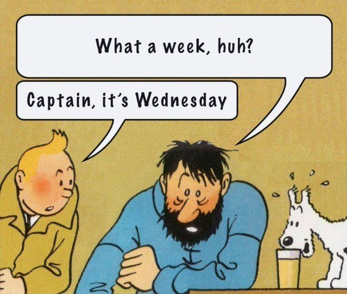

# A very bad week for Internet Security
{: .no_toc }



## What the hell is happening?
So it started out with one single tweet about two critical PHP vulnerabilities (`CVE-2026-109618` and `CVE-2026-109619`), which came to be known as PHP2Shell Vulnerability that was announced just a few days ago at the time of writing (Tuesday 20 October). Emergency security patches were released for these two immediately, following an earlier-than-planned release after details of these vulnerabilities were released.

Since then, even more vulnerabilities (not just from PHP) came to surface, one after another, affecting different services, platforms, etc., some straight up being extremely severe (such as the PHP one), others, not as much.

## Time to make a list
This list basically is a list of every single vulnerability classified as date-first, severity second sorting, which covers some of the most impactful vulnerabilities and issues, along with a few of my own comments, which I came across. Without further ado, allow me to list the following Hell on Earth: A very bad week for Internet Security. (Currently documenting October 19-22)

### Vulnerabilities & Security Updates
- Oct 22 - [Linux kernel - multiple prematurely disclosed vulnerabilities](https://www.phoronix.com/news/LKML-New-Trend-Vulnerabilities) - CVSS up to 9.0: Apparently accidental public reports expose SMB-related RCE, local privilege-escalation, and information-disclosure flaws before mainline fixes are available. (Six reports discussed; one was posted the previous day. Some fixes are undergoing testing or queued.)
  - Additional note: Greg Kroah-Hartman's response to Trend Micro who leaked it: "Again, no patch, and sent to a public list? Please fix your submission process..."
- Oct 21 - [GitLab CE/EE](https://docs.gitlab.com/releases/patches/patch-release-gitlab-19-5-1-released/) - CVSS 10.0: Regex compiler overflow can permit unauthenticated server takeover; release fixes 12 vulnerabilities.
  - Additional note: This only affects self-hosted repositories, not the cloud-hosted offered by GitLab themselves.
- Oct 21 - [Best Practice Software Bp Premier](https://github.com/advisories/GHSA-hmqc-m6cv-3c9r) - CVSS 9.8: Shared hardcoded SQL Server administrator credentials allow database takeover and potentially SYSTEM command execution. (CVE-2026-114119; affects versions before 1.14.1.1128.)
- Oct 21 - [PHP](https://www.php.net/archive/2026.php) - CVSS v4.0 9.2: Two memory-safety flaws let unauthenticated web requests execute server-side code. (CVE-2026-109618 and CVE-2026-109619; fixed in 8.5.12, 8.4.27, 8.3.36, and 8.2.35.)
- Oct 21 - [Oracle Java SE/GraalVM](https://www.oracle.com/security-alerts/alert-cve-2026-91403.html) - CVSS 9.1: Compromised CA certificates permit forged TLS identities, enabling data interception and modification. (CVE-2026-91403; related to eMudhra.)
- Oct 21 - [Apache Traffic Server](https://github.com/advisories/GHSA-4h97-h3mf-j6w7) - CVSS 9.1: Premature origin-connection reuse enables request smuggling, access-control bypass, and cache poisoning. (CVE-2025-31699; fixed in 9.2.16, 10.1.5, and 10.2.1.)
- Oct 21, date provisional - [Astral uv](https://app.opencve.io/cve/CVE-2026-114109) - CVSS 8.8: Malicious Python wheels use entry-point path traversal to overwrite executables outside the scripts directory, enabling code execution. (CVE-2026-114109; fixed in 0.11.15.)
- Oct 21 - [Node.js](https://github.com/nodejs/nodejs.org/blob/main/apps/site/pages/en/blog/vulnerability/october-2026-security-releases.md) - High maximum: Ten flaws include Brotli RCE, TLS verification bypasses, repeated randomness, and permission bypasses. (Fixed in 22.23.4, 24.22.1, and 26.12.1.)
- Oct 21 - [Apache Traffic Server](https://app.opencve.io/cve/CVE-2025-55702) - Score unverified: Early responses to `Expect: 100-continue` requests leave unread bodies that are parsed as new requests, enabling request smuggling and response desynchronization. (CVE-2025-55702; fixed in 9.2.16, 10.1.5, and 10.2.1.)
- Oct 20 - [Google Chrome](https://www.tenable.com/cve/CVE-2026-113072) - CVSS 9.6: CSS memory corruption lets a crafted HTML page potentially execute arbitrary code outside the browser sandbox. (CVE-2026-113072; fixed in 156.0.8078.47.)
- Oct 20 - [Next.js](https://www.csa.gov.sg/alerts-and-advisories/alerts/al-2026-148/) - CVSS v4.0 9.5: Two RCE flaws affect specific caching configurations and glibc-based image processing. (CVE-2026-96889 and GHSA-673q-mjm6-r5xr; advisory identifies fixes in 15.5.28 and 16.4.1.)
- Oct 20 - [FreeRDP](https://access.redhat.com/security/cve/cve-2026-114045) - CVSS 8.8: An authenticated RDP client can trigger a server-side audio-channel heap overflow, potentially compromising the server. (CVE-2026-114045; fixed in 3.32.1.)
- Oct 20 - [Go](https://thehackernews.com/2026/10/eight-emudhra-ca-keys-compromised.html) - Certificate-trust remediation: Updates reject compromised eMudhra keys; affected applications need rebuilding. (CVE-2026-111943; related to eMudhra, not a separate compromise.)
- Oct 20 - [Firefox/NSS](https://blog.mozilla.org/security/2026/10/20/protecting-firefox-users-following-the-compromise-of-emudhra-intermediate-certificates/) - Certificate-trust remediation: Browser and trust-store updates block compromised eMudhra certificate chains. (Related to eMudhra, not a separate compromise.)
- Oct 19, date provisional - [IBM DataStage on Cloud Pak for Data](https://www.rapid7.com/db/vulnerabilities/cve-2026-81212/) - CVSS 10.0: Unauthenticated attackers can overwrite other tenants’ Redis keys, undermining credential-encryption boundaries and cached flow data. (CVE-2026-81212; affects 5.4.0.0.)

### Breaches, Infrastructure Incidents & Attack Campaigns
- Oct 22 - [Capcom - CAPCOM ID](https://www.capcom.co.jp/ir/english/news/html/e261022.html) - Confirmed breach; no CVSS or exploit disclosed: Email addresses and account metadata exposed for 11,774,247 accounts worldwide; 196 accounts had passwords illicitly changed and subsequently reset. (Credit-card information excluded; no leakage of user-set passwords confirmed; containment measures completed, with investigation ongoing.)
- Oct 21 - [CyberCartel - Latin American financial targets](https://x.com/cyber_razz/status/2112960157642641848) - Reported attack campaign; no CVSS: AI agents using Claude, Grok, and Moonshot models reportedly automated attacks against 400+ financial targets. (According to Straiker research; target count is not a confirmed breach count.)
- Oct 21 - [Railway](https://blog.railway.com/p/security-disclosure-wednesday-october-21st) - Potential secret exposure; no CVSS listed: Unauthorized access may have exposed customer environment variables, including some decrypted secrets.
- Oct 21 - [Palo Alto PAN-OS GlobalProtect](https://www.helpnetsecurity.com/2026/10/21/ransomware-groups-exploit-palo-alto-globalprotect-cve-2026-0257/) - Active exploitation; score not verified: Ransomware groups exploit an older authentication bypass to enter vulnerable networks. (CVE-2026-0257; retained for new exploitation reporting, not as a new vulnerability.)
- Oct 20 - [eMudhra/emSign](https://www.csoonline.com/article/4238338/google-mozilla-revoke-emudhra-intermediates-after-private-key-compromise.html) - CA key compromise; no CVSS listed: Eight recoverable intermediate CA keys enable forged certificates against clients that still trust them. (Related remediation appears under Java, Go, and Firefox/NSS.)
  - Additional note: 8 keys were disclosed, one of which was literally just `4`... All others were of numerical values less than 256.
- Oct 19 - [BeyonddTrust Remote Support - formerly Bomgar](https://www.rapid7.com/blog/post/etr-cve-2026-102764-critical-beyondtrust-remote-support-authentication-bypass-exploited-in-the-wild/) - CVSS v4.0 9.3: Actively exploited authentication bypass allows unauthenticated file operations, potentially leading to appliance takeover and credential exposure. (CVE-2026-102764; affects versions through 26.2.3 unless patched with BT26-05-RS; original disclosure Oct 15.)
- Oct 19 - [Plex Media Server](https://arstechnica.com/security/2026/10/recently-fixed-plex-media-vulnerabilities-are-being-exploited-to-install-malware/) - CVSS 8.6, highest component: Four previously patched flaws are chained to install miners and proxy malware. (CVE-2026-96652, -96654, -96655, and -96656; retained for new exploitation reporting.)
- Oct 19 - [Siemens Software Center](https://productcert.siemens.com/news/2026/10/19/active-exploitation-of-cve-2026-110936-in-siemens-software-center/) - CVSS v4.0 8.4: Attackers exploit DLL side-loading to execute malicious code with the application’s privileges. (CVE-2026-110936; exploitation confirmed by Siemens; fixed in 4.0.9.8.)
- Oct 19 - [EG Secure Solutions SiteGuard Server Edition](https://securityaffairs.com/201258/security/japans-siteguard-waf-flaw-cve-2026-106931-is-already-being-exploited.html) - CVSS v4.0 8.5: Actively exploited statistics-feature command injection lets a low-privileged local attacker execute commands as root or SYSTEM. (CVE-2026-106931; original disclosure Oct 14; fixes available.)
- Oct 19 - [TiDB Cloud/PingCAP](https://www.pingcap.com/trust-hub/security/security-update-october-2026/) - Confirmed breach; no CVSS listed: Stolen service credentials exposed source code and customer records; database-content theft remains unestablished.

### Supply-Chain Compromises
- Oct 21 - [LiteLLM](https://www.wiz.io/blog/litellm-compromised-steals-credentials) - Confirmed supply-chain compromise; no CVSS listed: Malicious version 1.107.0 installs credential-stealing Python startup hooks and a remote-code loader. (Affected PyPI and container artifacts require rebuilding and exposed-secret rotation, not merely an upgrade.)

### Header Accordions - Disclosure Date Unverified
These implementations were reported as unpatched; their exact disclosure date and maintainer-confirmed patch status remain unverified.

- Date unverified - [Bun 1.4.3](https://foxio.io/blog/header-accordions-qpack-amplification-attacks-against-http-3-servers) - Remote DoS; CVSS unverified: Tiny compressed HTTP/3 headers expand into excessive memory allocations.
- Date unverified - [Hyperium h3](https://foxio.io/blog/header-accordions-qpack-amplification-attacks-against-http-3-servers) - Remote DoS; CVSS unverified: Inadequate decoded-header limits allow QPACK expansion to exhaust resources.
- Date unverified - [aioquic/mitmproxy](https://foxio.io/blog/header-accordions-qpack-amplification-attacks-against-http-3-servers) - Remote DoS; CVSS unverified: QPACK header amplification exhausts memory during HTTP/3 processing.

---

---
## Credits:
Thank you to my friends at the discord servers for [r/techsupport](https://www.reddit.com/r/techsupport/), [PCHH](https://pchelphub.com/) and [r/buildaPC](https://www.reddit.com/r/buildapc/): `beandotmp3`, `solus_bellator`, `itsblados`, `codepanda`, `sleepyhampter` and `goodblobplsgivecookie` for feeding me info into what CVEs to look for to make this list.