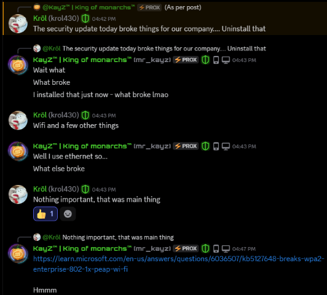

# Windows update breaking enterprise network configurations
{: .no_toc }



## Background
Enterprise networks often use authentication configurations such as WPA2‑Enterprise and 802.1X, rather than the WPA2/3‑Personal configurations typically used for home Wi-Fi. The issue discussed here concerns configurations using PEAP/MS‑CHAPv2 for authentication.

{: .important }
> **This primarily affects enterprise-grade networking configurations**, according to the documentation and update notes currently available. In theory, this update *should not affect general home Wi-Fi utilization! (i.e. WPA2/3-Personal)*

## Main issue
Another Windows update, another broken network configuration...

{: .quote }
> *"At least it wasn't on a Friday..."* - User on Reddit

Update KB5127648 is reportedly affecting WPA2‑Enterprise networking (802.1X PEAP/MS‑CHAPv2), resulting in connectivity failures. This update was released exactly at 10:00 AM Pacific Time (PST/PDT) on October 13th 2026 (Patch Tuesday) .

According to multiple reports in PC Help Hub, r/techsupport discord server, and [Microsoft support forums](https://learn.microsoft.com/en-us/answers/questions/6036507/kb5127648-breaks-wpa2-enterprise-802-1x-peap-wi-fi), the update appears to affect enterprise networking configurations by [restricting NTLMv1-derived cryptography](https://support.microsoft.com/en-us/servicing/os/windows/docs/2025/08/upcoming-changes-to-ntlmv1-in-windows-11-version-24h2-and-windows-server-2025) used in MS‑CHAPv2 authentication. This may affect services such as Wi-Fi, wired Ethernet using 802.1X, and VPNs that rely on the affected authentication configuration.

<figure>
	
	<figcaption>User Krol430 informing me of the issue on the r/techsupport discord server</figcaption>
</figure>

Naturally, tightening authentication restrictions can cause problems for configurations that still depend on what is being restricted. Another exciting day in enterprise networking.

---
## Symptoms and diagnosis
- Connectivity failures after installing KB5127648 on systems using WPA2‑Enterprise with 802.1X PEAP/MS‑CHAPv2.
- Potential authentication failures affecting other services using the same authentication configuration, such as wired Ethernet using 802.1X or VPNs.
- There are also *potential reports, unverified at the time of writing,* of home users being unable to connect to their own routers.
    - These reports currently lack sufficient detail to establish whether they are related to the enterprise authentication issue.
    - General reports of "My Wi-Fi isn't working!" do not provide enough information to identify the cause. Understandable, but unfortunately not quite a diagnosis.

### Potential explanations for home-user reports
Playing the Devil's advocate, and assuming home users are affected in some way, a few potential explanations come to mind:

- **Coincidental driver issues**: Intel, Qualcomm, Realtek, or MediaTek drivers may have encountered a separate compatibility issue with the update. Apparently, enterprise authentication does not need to have a monopoly on broken networking.
- **WLAN network profile corruption**: The update may have exposed pre-existing WLAN configuration issues.
- **Enterprise-like configurations used at a user level**: Some home or ISP-managed networks may use enterprise authentication configurations, potentially involving WPA2‑Enterprise and services such as FreeRADIUS or NPS. These could make an otherwise home-user setup susceptible to the PEAP/MS‑CHAPv2 issue.

These are potential explanations, not confirmed causes. The available reports do not currently establish that standard WPA2/3‑Personal home networks are affected by the same issue.

## Potential solutions
Currently reported workarounds are:
- Uninstalling the update entirely.
- Setting a DWORD value named `BlockNtlmv1SSO` to `0` under `HKLM\SYSTEM\CurrentControlSet\Control\Lsa\MSV1_0` in the registry.

{: .warning }
> These should be treated as temporary workarounds rather than permanent fixes. Uninstalling a security update or relaxing authentication restrictions has security implications, so changes to managed systems should be coordinated with the responsible IT administrator.

{: .important }
> **Contact your Internet Service Provider**
> If you are wary of messing around in registry, its best to contact your Internet Service Provider (ISP) to resolve this issue as fast as possible.

---
## References
- [Microsoft KB5127648 update notes](https://support.microsoft.com/en-us/servicing/os/windows-11/2026/10/kb5127648-windows-11-24h2-25h2-26h2-security-update)